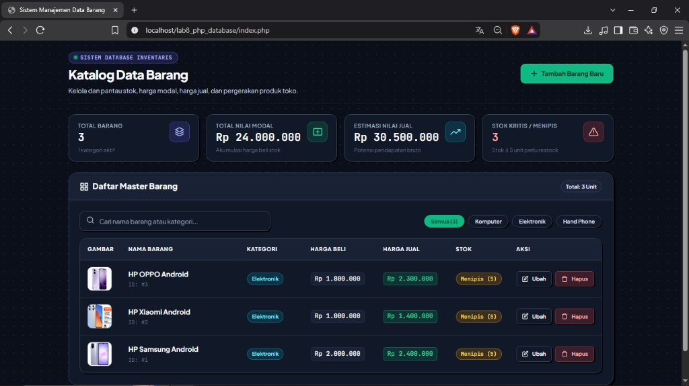
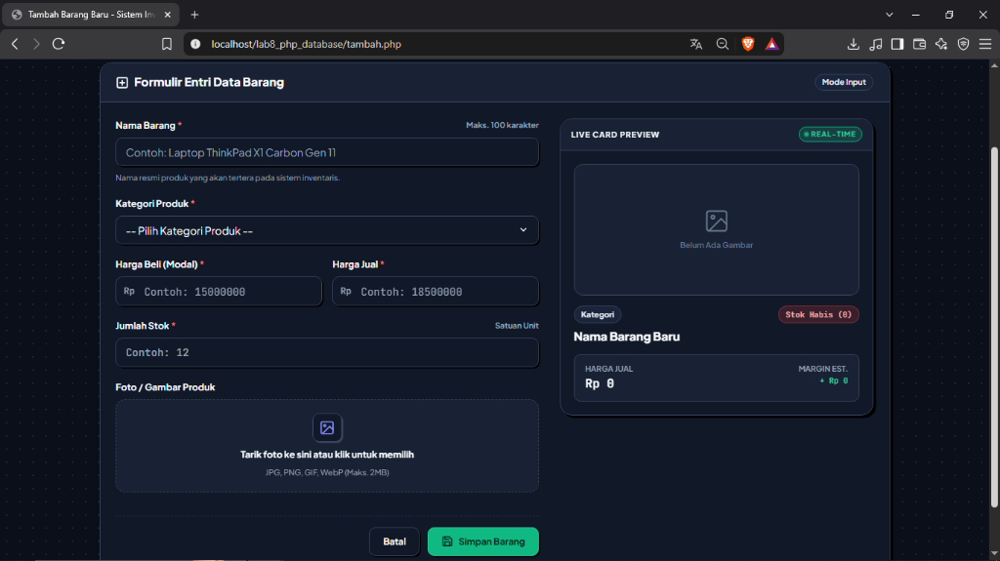
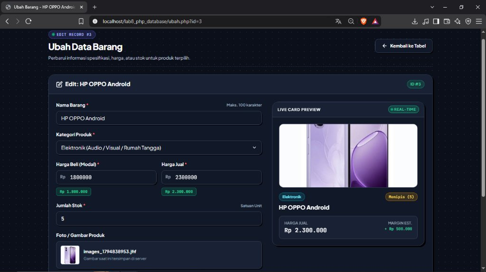

# Praktikum 8: PHP dan Database MySQL

**Mata Kuliah:** Pemrograman Web OBE  
**Modul Praktikum:** Praktikum 8 - PHP dan Database MySQL  
**Topik:** Penerapan Konsep CRUD (Create, Read, Update, Delete) Berbasis PHP & MySQL dengan Desain Modern Adaptif  

---

## Daftar Isi
- [Tujuan Praktikum](#tujuan-praktikum)
- [Instruksi Tugas Praktikum](#instruksi-tugas-praktikum)
- [Struktur Direktori Project](#struktur-direktori-project)
- [Langkah-Langkah Praktikum](#langkah-langkah-praktikum)
  - [1. Persiapan Database MySQL](#1-persiapan-database-mysql)
  - [2. Membuat File Koneksi Database (`koneksi.php`)](#2-membuat-file-koneksi-database-koneksiphp)
  - [3. Menampilkan Data / Read (`index.php`)](#3-menampilkan-data--read-indexphp)
  - [4. Menambah Data / Create (`tambah.php`)](#4-menambah-data--create-tambahphp)
  - [5. Mengubah Data / Update (`ubah.php`)](#5-mengubah-data--update-ubahphp)
  - [6. Menghapus Data / Delete (`hapus.php`)](#6-menghapus-data--delete-hapusphp)
- [Fitur Unggulan UI/UX & Optimasi Tema](#fitur-unggulan-uiux--optimasi-tema)
  - [A. Konsep Neo-Craft & Bento Grid](#a-konsep-neo-craft--bento-grid)
  - [B. Otomasi Mode Terang & Gelap (Auto System Mode)](#b-otomasi-mode-terang--gelap-auto-system-mode)
  - [C. Fitur Interaktif Tambahan](#c-fitur-interaktif-tambahan)
- [Panduan Menjalankan Project di Lokal](#panduan-menjalankan-project-di-lokal)

---

## Tujuan Praktikum
1. Mahasiswa mampu memahami konsep dasar *Database Relasional*.
2. Mahasiswa mampu memahami konsep dasar **CRUD** (*Create, Read, Update, Delete*) menggunakan PHP.
3. Mahasiswa mampu membuat aplikasi web berbasis PHP yang terhubung dengan database MySQL secara aman, modular, dan terstruktur.

---

## Instruksi Tugas Praktikum
Sesuai instruksi modul praktikum:
1. Membuat database `latihan1` dan tabel `data_barang`.
2. Mengisi data awal dummy pada tabel `data_barang`.
3. Membangun modul koneksi database (`koneksi.php`).
4. Membangun antarmuka untuk membaca data barang (`index.php`).
5. Membangun formulir tambah data barang beserta upload file gambar (`tambah.php`).
6. Membangun formulir ubah data barang beserta penggantian gambar (`ubah.php`).
7. Membangun script hapus data barang (`hapus.php`).
8. Membuat dokumentasi laporan lengkap pada `README.md` dan melakukan push ke repositori GitHub.

---

## Struktur Direktori Project

```plaintext
lab8_php_database/
│
├── .agents/                    # Konfigurasi skill UI/UX Pro Max & Desain
│   └── skills/
├── gambar/                     # Direktori penyimpanan file gambar produk
├── screenshots/                # Tangkapan layar antarmuka pengguna (UI)
│   ├── index.jpg
│   ├── tambah.png
│   └── ubah.jpg
├── hapus.php                   # Controller untuk menghapus data barang
├── index.php                   # Halaman utama (Read / Menampilkan daftar barang)
├── koneksi.php                 # Modul koneksi ke database MySQL
├── style.css                   # Stylesheet utama (Neo-Craft Design System)
├── tambah.php                  # Halaman & form tambah data barang (Create)
├── ubah.php                    # Halaman & form edit data barang (Update)
└── README.md                   # Dokumentasi laporan praktikum
```

---

## Langkah-Langkah Praktikum

### 1. Persiapan Database MySQL

Pastikan web server Apache dan MySQL Server telah aktif (melalui Laragon atau XAMPP Control Panel).

#### A. Membuat Database
Buka **phpMyAdmin** (`http://localhost/phpmyadmin/`) atau terminal MySQL, lalu jalankan query:

```sql
CREATE DATABASE IF NOT EXISTS latihan1;
USE latihan1;
```

#### B. Membuat Tabel `data_barang`
Struktur tabel untuk menampung data inventaris barang:

| Nama Field | Tipe Data | Ukuran | Keterangan |
| :--- | :--- | :--- | :--- |
| `id_barang` | INT | 10 | Primary Key, Auto Increment |
| `kategori` | VARCHAR | 30 | Kategori produk |
| `nama` | VARCHAR | 50 | Nama barang |
| `gambar` | VARCHAR | 100 | Path/nama file gambar |
| `harga_beli` | DECIMAL | 10,0 | Harga modal produk |
| `harga_jual` | DECIMAL | 10,0 | Harga jual produk |
| `stok` | INT | 4 | Jumlah ketersediaan stok |

Query SQL:
```sql
CREATE TABLE data_barang (
    id_barang INT(10) AUTO_INCREMENT PRIMARY KEY,
    kategori VARCHAR(30) NOT NULL,
    nama VARCHAR(50) NOT NULL,
    gambar VARCHAR(100) DEFAULT NULL,
    harga_beli DECIMAL(10,0) NOT NULL,
    harga_jual DECIMAL(10,0) NOT NULL,
    stok INT(4) NOT NULL
);
```

#### C. Menambahkan Data Dummy Awal
```sql
INSERT INTO data_barang (kategori, nama, gambar, harga_beli, harga_jual, stok)
VALUES 
('Elektronik', 'HP Samsung Android', 'hp_samsung.jpg', 2000000, 2400000, 5),
('Elektronik', 'HP Xiaomi Android', 'hp_xiaomi.jpg', 1000000, 1400000, 5),
('Elektronik', 'HP OPPO Android', 'hp_oppo.jpg', 1800000, 2300000, 5);
```

---

### 2. Membuat File Koneksi Database (`koneksi.php`)
File ini bertanggung jawab menghubungkan aplikasi PHP dengan server basis data MySQL menggunakan ekstensi `mysqli`.

```php
<?php
$host = "localhost";
$user = "root";
$pass = "";
$db   = "latihan1";

$conn = mysqli_connect($host, $user, $pass, $db);

if ($conn == false) {
    echo "Koneksi ke server gagal: " . mysqli_connect_error();
    die();
}
?>
```

---

### 3. Menampilkan Data / Read (`index.php`)
Halaman ini menampilkan seluruh data dari tabel `data_barang` dalam bentuk tabel terstruktur serta ringkasan metrik statistik (*Bento Stat Cards*).

**Fitur pada halaman ini:**
- **Bento Metric Cards:** Menghitung total barang, total nilai aset/modal, estimasi nilai penjualan kotor, dan peringatan stok menipis (&le; 5 unit).
- **Pencarian Real-Time & Filter Kategori:** Filter interaktif berbasis JavaScript untuk mencari nama barang atau memilih kategori tanpa reload.
- **Penyajian Data:** Thumbnail gambar produk, lencana kategori warna-warni, format mata uang Rupiah (`JetBrains Mono`), dan tombol aksi (*Ubah* & *Hapus*).

#### Tangkapan Layar Halaman Utama (Index):


---

### 4. Menambah Data / Create (`tambah.php`)
Halaman formulir untuk mendaftarkan barang baru ke database dengan dukungan pengunggahan berkas gambar produk.

**Logika Backend:**
- Mengambil nilai input dari array global `$_POST` dan `$_FILES`.
- **Validasi Data:** Memastikan nama, kategori, harga beli, harga jual, dan stok bernilai valid dan positif.
- **Penanganan Berkas Gambar:** Memvalidasi format MIME (JPG, PNG, GIF, WebP) dan batasan ukuran maksimal (2 MB). Berkas kemudian dipindahkan ke folder `gambar/` menggunakan `move_uploaded_file()`.
- Menjalankan perintah `INSERT INTO data_barang` dan mengarahkan kembali ke `index.php`.

**Fitur Antarmuka:**
- Layout 2 kolom (*Formulir Input* di kiri, *Live Card Preview* di kanan).
- Pratinjau instan foto yang dipilih sebelum disubmit.
- Live format mata uang Rupiah otomatis saat mengetik angka nominal.

#### Tangkapan Layar Formulir Tambah Barang:


---

### 5. Mengubah Data / Update (`ubah.php`)
Halaman formulir untuk memperbarui informasi barang yang sudah ada di database.

**Logika Backend:**
- Menangkap parameter ID melalui `$_GET['id']` atau `$_POST['id']`.
- Mengambil rekaman data lama dari tabel `data_barang` untuk mengisi nilai awal formulir (*prefill*).
- Jika ada gambar baru yang diunggah, file gambar lama akan dihapus dan digantikan berkas baru. Jika tidak diunggah, path gambar lama tetap dipertahankan.
- Menjalankan perintah `UPDATE data_barang SET ... WHERE id_barang = '...'`.

#### Tangkapan Layar Formulir Ubah Barang:


---

### 6. Menghapus Data / Delete (`hapus.php`)
Modul eksekusi untuk menghapus rekaman data barang dari tabel berdasarkan ID.

```php
<?php
include_once 'koneksi.php';

$id = $_GET['id'] ?? null;
if ($id) {
    $sql = "DELETE FROM data_barang WHERE id_barang = '" . mysqli_real_escape_string($conn, $id) . "'";
    $result = mysqli_query($conn, $sql);
}

header('location: index.php');
exit;
?>
```

---

## Fitur Unggulan UI/UX & Optimasi Tema

### A. Konsep Neo-Craft & Bento Grid
Antarmuka didesain khusus agar **tidak pasaran** (berbeda dari template tabel default biasa):
- **Borders & Shadows:** Border solid berukuran `2px` dipadukan dengan bayangan tegas (*hard offset shadow* `4px 4px 0px`) yang memberikan kesan tactile dan modern.
- **Tipografi:** Kombinasi **Plus Jakarta Sans** (tegas dan proporsional untuk heading/teks) dan **JetBrains Mono** (rapi untuk harga, stok, dan ID).
- **Background Pattern:** Latar belakang canvas bersih dengan pola *technical dot-grid* (`radial-gradient`).

### B. Otomasi Mode Terang & Gelap (Auto System Mode)
Website secara otomatis mendeteksi dan menyesuaikan mode tampilan perangkat pengguna tanpa perlu tombol manual:
- Menggunakan CSS modern `color-scheme: light dark;` dan media query `@media (prefers-color-scheme: dark)`.
- **Keterbacaan Font Terjamin (WCAG AAA):**
  - Pada mode gelap, teks utama menggunakan `#F8FAFC` dengan rasio kontras **15:1** terhadap latar kartu (`#111827`).
  - Lencana kategori dan status stok secara cerdas mengubah warna teks menjadi berpendar terang (misal: hijau `#34D399` untuk stok tersedia) dengan latar transparan gelap agar tidak terjadi masalah *dark text on dark background*.
  - Elemen `<select>` dan `<option>` dioptimalkan agar selalu kontras pada berbagai sistem operasi (Windows / macOS).

### C. Fitur Interaktif Tambahan
1. **Live Interactive Card Preview**: Pengguna dapat melihat langsung simulasi kartu produk di sebelah kanan form saat mengisi nama, harga, stok, dan gambar.
2. **Live Currency Formatter**: Mengonversi input mentah (misal: `2500000`) menjadi label Rupiah yang rapi (`Rp 2.500.000`) untuk meminimalisir kesalahan input digit.
3. **Instant Filter & Search**: Pencarian data instan di `index.php` tanpa perlu memuat ulang halaman.

---

## Panduan Menjalankan Project di Lokal

1. **Clone Repositori**:
   ```bash
   git clone https://github.com/rasyafakhri/Lab-8.git
   ```
2. **Pindahkan ke Webroot**:
   Pastikan folder project berada pada direktori web server:
   - Laragon: `C:\laragon\www\lab8_php_database`
   - XAMPP: `C:\xampp\htdocs\lab8_php_database`
3. **Import Database**:
   - Buka phpMyAdmin (`http://localhost/phpmyadmin/`).
   - Buat database dengan nama `latihan1`.
   - Jalankan query SQL pembuatan tabel `data_barang` yang tertera pada bagian [Langkah-Langkah Praktikum](#1-persiapan-database-mysql).
4. **Buka Aplikasi**:
   Akses melalui browser di alamat:
   ```plaintext
   http://localhost/lab8_php_database/
   ```

---

*Laporan Praktikum Pemrograman Web OBE - Praktikum 8: PHP dan Database MySQL*  
